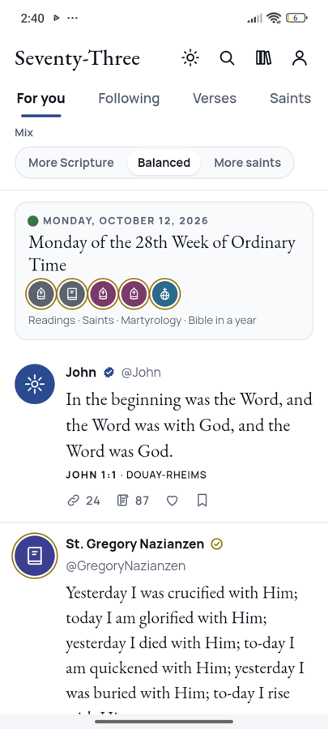

# Seventy-Three

**The Catholic Bible as a feed.** Each of the 73 books of the Douay-Rheims Bible is an account that posts its verses. Other books reply with cross-references, and the Church Fathers and the saints comment in their own words. It's free, works offline, and has no accounts, ads or tracking.

<p align="center"></p>

## What's inside

- **The whole Catholic Bible**: the Douay-Rheims (Challoner revision, 1899), all 73 books and 35,811 verses, with each verse's number in modern Bibles where it differs.
- **Books answering books**: 464,000 cross-references from OpenBible.info, shown as replies you can follow from verse to verse. The deuterocanonical books get theirs from the verses that Haydock and Challoner cite.
- **The Fathers on every verse**: over 52,000 comments from the Catena Aurea of St. Thomas Aquinas, the Ante-Nicene and Nicene Fathers, Haydock's commentary and Challoner's notes.
- **Saints**: 1,037 saints and blesseds with profiles, feast days and patronages. 158 accounts, from the Blessed Virgin and the apostles to the Didache and St. Bernadette, post their own words: about 2,600 quotations, copied word for word from public-domain translations, or translated for this app from the original, which is shown alongside.
- **Today**: the liturgical day and colour, the Mass readings in the Douay-Rheims text (General Roman Calendar, United States or Canada, through 2030), the saints of the day, the Roman Martyrology and a Bible-in-a-year plan.
- **Yours, on your device**: likes, bookmarks, notes, the books and saints you follow, and your reading plan. Back them up to a file and load it on another device.
- **Read aloud, share as an image, search** verses, books and saints.

## Use it

- **Android**: download `Seventy-Three.apk` from the [latest release](https://github.com/faustogq/seventy-three/releases/latest) and open it on the phone (allow installing from your browser or file manager when asked). Everything, including all the commentary, is inside the app.
- **iPhone, Android or computer, in the browser**: open **https://faustogq.github.io/seventy-three/** and install it from the browser menu ("Add to Home Screen" on iPhone, "Install app" on Android). After the first visit it works offline. The commentary is saved book by book as you open it, or all at once from Settings.

## Not an official publication

Seventy-Three is not an official publication of the Catholic Church. The saint profiles were written with the help of AI and checked against public sources, and the reading references were checked against the *Ordo Lectionum Missae*. Mistakes are still possible. If you find one, please [open an issue](https://github.com/faustogq/seventy-three/issues) with the correct information and its source.

## Privacy

The app collects nothing. There are no accounts, analytics or ads. Everything you save stays on your device. Links to sources open in your browser.

## Build it

The app is plain HTML, CSS and JavaScript with no framework and no dependencies.

```
python3 build/assemble.py      # builds the web app (offline-app/) and the files for Android
./android/build-apk.sh         # builds android/Seventy-Three.apk (needs JDK 17 and the Android SDK; see the script)
```

To try the web app locally, serve the folder (for example `python3 -m http.server`) and open `offline-app/`.

| Folder | What it is |
|---|---|
| `v7/` | The app's source: head and styles, core, storage, rendering, events |
| `data/` | The Bible, cross-references, commentary, saints, quotations, calendar and readings (see [data/README.md](data/README.md)) |
| `build/` | The build script, fonts, icons, book descriptions and the offline service worker template |
| `android/` | The Android app: one Activity that runs the web app from the APK's own files and connects it to the phone (saving files, reading aloud, back button) |

## Licenses

- **Code**: [MIT](LICENSE).
- **Original content** (saint profiles, emblems, book icons and descriptions, design): [CC BY 4.0](LICENSE-CONTENT.txt).
- **Texts and data from other sources** keep their own terms, mostly public domain. See [THIRD_PARTY.md](THIRD_PARTY.md).
